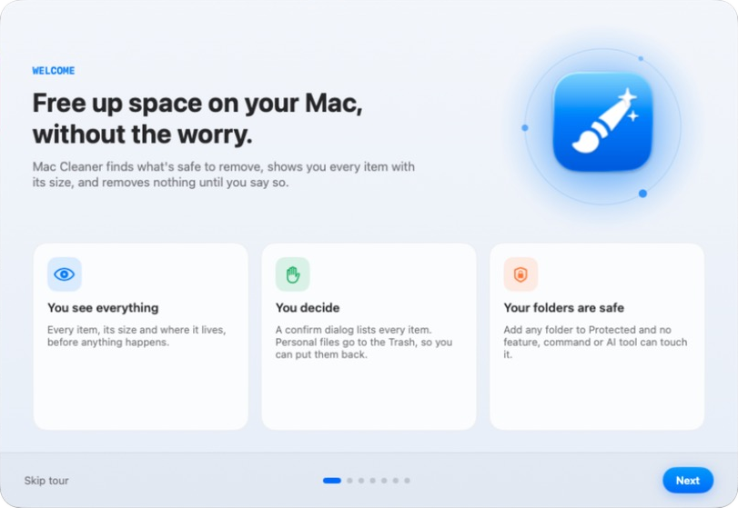
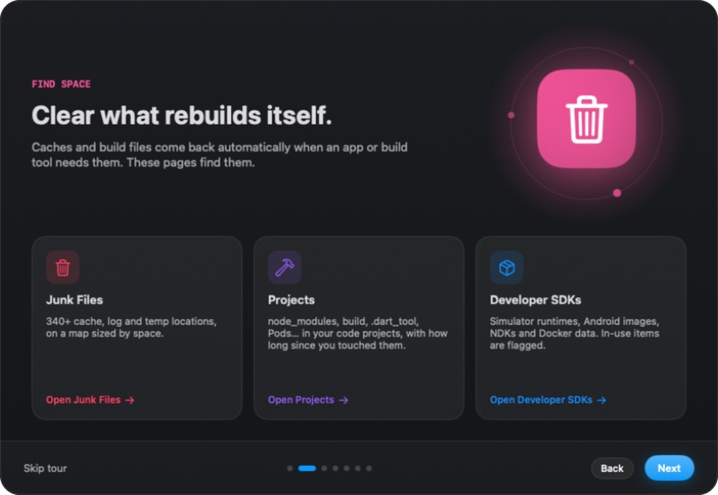
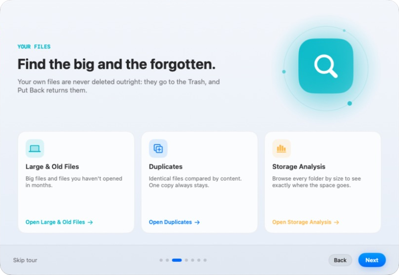
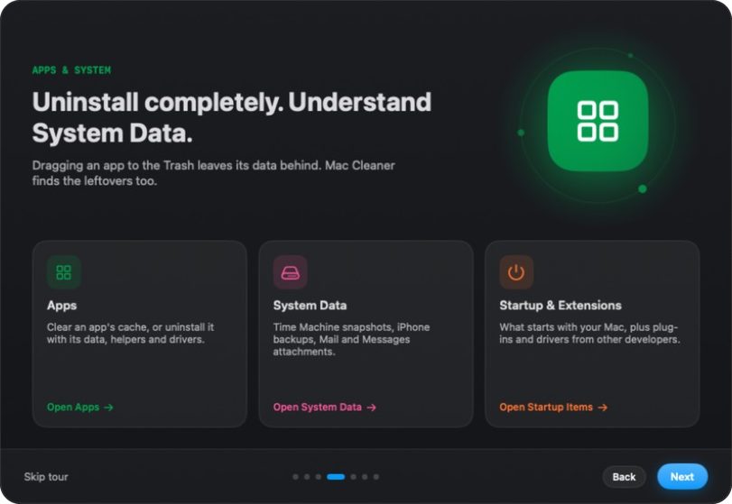

# Mac Cleaner

[](https://github.com/WahdanZ/MacCleaner/actions/workflows/ci.yml) [](LICENSE) 

A native macOS app that frees disk space **safely**. It shows every item with its size, removes nothing until you confirm, and sends your own files to the Trash, so you can put them back.

Built for developers: it knows about Xcode, simulators, Android SDKs, Gradle, Flutter, npm/yarn/pnpm/bun, CocoaPods, Docker and `node_modules`. It also covers app caches, logs, large files, duplicates and complete app uninstalls.

You can use it in three ways:

| | |
|---|---|
| **App** | SwiftUI window with light and dark mode, plus a menu bar icon |
| **Command line** | `mac-cleaner status`, `mac-cleaner clean --recommended`, … |
| **AI assistants** | Built-in MCP server with 21 tools for Claude, Cursor, Codex, VS Code, Windsurf and Gemini |

All three run the same engine with the same safety rules.

<p align="center">
  <picture>
    <source media="(prefers-color-scheme: dark)" srcset="docs/screenshots/tour-welcome-dark.png">
    
  </picture>
</p>

| | |
|---|---|
|  |  |
|  |  |

<sub>Pages from the built-in tour, in dark and light mode.</sub>

---

## Features

### Find space
- **Junk Files:** 340+ cache, log and temp locations, shown on a map sized by disk space. Covers:
  - Xcode DerivedData, DeviceSupport and simulator caches
  - Gradle, emulators, pub, npm, Homebrew and editor caches
  - App and browser/Electron caches
  - Logs
- **Projects:** finds `node_modules`, `build`, `.dart_tool`, `.gradle`, `Pods`, `target`, `.next` and similar folders in your code folders. Filter by how long since you last worked on each project. `dist` and virtualenvs are marked REVIEW.
- **Developer SDKs:**
  - Simulator runtimes, DeviceSupport and Xcode archives
  - Android system images, platforms, NDKs, build tools and emulators
  - Docker images, containers, volumes and build cache

  Items your projects still use are flagged **IN USE**. This is read from `compileSdk`, `ndkVersion` and `buildToolsVersion` in your Gradle files, and from your emulators' configs.

### Your files
- **Large & Old Files:** big files and files you haven't opened in months.
- **Duplicates:** compared by content (size, then partial hash, then full SHA-256). One copy always stays.
- **Storage Analysis:** browse every folder by size.
- **Shredder:** delete files permanently, skipping the Trash.

### Apps and system
- **Apps:** clear an app's cache, or uninstall it completely. That includes its Library data, launch agents and daemons, helpers, audio drivers and installer receipts.
- **System Data:** Time Machine local snapshots, iPhone/iPad backups, Mail and Messages attachments, purgeable space and swap.
- **Extensions and Startup Items:** plug-ins, panes and drivers from other developers, and what starts with your Mac.

### Automation (off by default, except the alert)
- **Low-disk alert:** the menu bar icon turns orange, then red, and a notification appears when free space drops below your limit. The default limit is 20 GB.
- **Weekly safe clean:** recommended caches only. It never touches the Trash, Downloads, your folders or protected items.
- **Open at login.**

### Polish
- **First-launch tour:** click **?** › *Take the tour* to see it again.
- **Animations:** page transitions, list rows that appear in sequence, and a "Freed X GB" message after each cleanup. Reduce motion is respected.

---

## Safety model

1. **Preview first.** Every action that deletes or moves files shows the full list with sizes. In the app this is a confirm dialog; in the CLI you type `yes`; over MCP the tool returns a preview until it is called again with `confirm: true`.
2. **Recoverable by default.** Only regenerable data (caches, build output, SDK downloads) is deleted outright. Your files go to the Trash, and the **Put Back** list restores them.
3. **Protected folders.** Add any folder or file in *Settings › Protected*. No page, command or AI tool can clean, trash, shred or uninstall it or anything inside it. AI tools can add protection but can't remove it.
4. **Guards** in [`SafetyGuard.swift`](MacCleaner/SafetyGuard.swift):
   - **`SafetyGuard`:** permanent deletion only inside known cache roots. Symlinks are resolved first, and the root folders themselves are never removed.
   - **`TrashGuard`:** never your home, Library, Documents and similar top-level folders, and never Keychains, Mail, Messages databases or `.ssh`.
   - **`AdminGuard`:** the password step may only touch direct children of a fixed list of system folders. Never `com.apple.*`.
5. **Self-test.** `"Mac Cleaner" --selftest` runs 78 checks against these rules. It uses throwaway files only. `build.sh` won't install a build that fails it.

**Not included on purpose:**
- Stripping language files from apps (breaks code signatures).
- Browser history and cookie cleaning.
- "RAM cleaners".

---

## Build and install

Requirements: macOS 14 or later, Xcode 16 or later.

```bash
git clone https://github.com/WahdanZ/MacCleaner.git && cd MacCleaner
./build.sh
```

`build.sh` does four things:
1. Builds a Release version.
2. Runs the self-test.
3. Signs it ad-hoc.
4. Installs it to `/Applications/Mac Cleaner.app`.

### Permissions
- **Full Disk Access** (optional, recommended). Without it macOS hides the Trash, Mail, Messages and other apps' data, so totals come out low. Grant it in *System Settings › Privacy & Security › Full Disk Access*.
- **Automation › Finder** is asked once, the first time you empty or measure the Trash.
- **Administrator password** is asked by macOS for items outside your home folder, for example `/Library/LaunchDaemons` or Time Machine snapshots.

> Ad-hoc signed builds get a new signature on every rebuild, so macOS may ask for Full Disk Access again. A Developer ID build fixes this; see [Distribution](#distribution).

---

## Command line

Install the `mac-cleaner` command, either from *Settings › Command line* or with:

```bash
"/Applications/Mac Cleaner.app/Contents/MacOS/Mac Cleaner" --cli install
```

It installs a small launcher in `/opt/homebrew/bin`, `/usr/local/bin` or `~/.local/bin`, whichever is writable. `mac-cleaner uninstall-command` removes it.

```bash
mac-cleaner status                       # free / used / total
mac-cleaner scan                         # read-only cache scan
mac-cleaner clean --recommended          # preview, then type yes
mac-cleaner usage ~/Library --limit 15   # biggest folders
mac-cleaner projects --idle 6            # build files in projects untouched for 6+ months
mac-cleaner clean-projects --all --idle 6
mac-cleaner sdks --group Android
mac-cleaner system-data
mac-cleaner uninstall "Some App"
mac-cleaner trash                        # Trash size + items Mac Cleaner put there
mac-cleaner put-back ID
mac-cleaner help                         # every command
```

- **`--json`:** machine-readable output.
- **`--yes`:** skips the question, for scripts. Without a keyboard prompt (a pipe or cron job) and without `--yes`, nothing is changed and the exit code is `2`.
- **`mac-cleaner tool NAME '{json}'`:** calls any MCP tool directly.

---

## AI assistants (MCP)

The app binary is also an MCP server over stdio:

```bash
"/Applications/Mac Cleaner.app/Contents/MacOS/Mac Cleaner" --mcp
```

To set it up, use *Settings › AI assistants › Connect AI…*. That screen configures:
- Claude Code
- Claude Desktop
- Cursor
- Codex
- VS Code
- Windsurf
- Gemini

It backs up each config file first and can also install a `mac-cleaner` skill that teaches the assistant the safety rules. Manual config:

```json
{
  "mcpServers": {
    "mac-cleaner": {
      "command": "/Applications/Mac Cleaner.app/Contents/MacOS/Mac Cleaner",
      "args": ["--mcp"]
    }
  }
}
```

| Read-only | Changes something (preview, then `confirm: true`) |
|---|---|
| `disk_status`, `scan_caches`, `disk_usage`, `find_duplicates`, `list_apps`, `app_details`, `scan_projects`, `list_sdks`, `system_data`, `trash_status`, `list_protected` | `clean_caches`, `clear_app_cache`, `uninstall_app`, `clean_projects`, `remove_sdks`, `remove_system_data`, `empty_trash`, `restore_from_trash`, `move_to_trash`, `protect_paths` (adds only) |

The server's instructions tell the assistant to show every item to the user and never to pass `confirm: true` on its own.

---

## Project layout

| File | What it does |
|---|---|
| `MacCleanerApp.swift` | Entry point: GUI, `--mcp`, `--cli`, `--selftest` |
| `SafetyGuard.swift` | `SafetyGuard`, `TrashGuard`, `ProtectedPaths` |
| `Scanner.swift`, `CleanTarget.swift`, `CleanerModel.swift` | Cache locations, measuring, cleaning |
| `Projects*.swift` | Project build-file finder |
| `DevSDK*.swift` | Xcode / Android / Docker SDK manager |
| `SystemData.swift` | Snapshots, backups, Mail, Messages |
| `AppsModel.swift`, `AppsView.swift` | App scan, leftovers, uninstall, `AdminGuard` / `AdminStep` |
| `Trash*.swift` | Trash size, empty, Put Back log |
| `Automation.swift` | Low-disk alert, weekly safe clean, login item |
| `MCPServer.swift`, `CLI.swift`, `Integrations*.swift` | MCP server, command line, AI app setup |
| `SelfTest.swift` | Safety self-test |
| `Theme.swift`, `Motion.swift`, `Intro.swift` | Design system, animations, tour |
| `ROADMAP.md` | What's done and what's next |

The Xcode project uses a synchronized folder, so new `.swift` files in `MacCleaner/` are picked up automatically.

---

## Distribution

### Download

Get the latest DMG from [Releases](https://github.com/WahdanZ/MacCleaner/releases), open it, and drag **Mac Cleaner** to Applications. Each release has a `.sha256` file to check the download:

```bash
shasum -a 256 -c MacCleaner-1.0.0.dmg.sha256
```

If a release isn't notarized, macOS blocks it the first time you open it. To allow it, open *System Settings › Privacy & Security* and click **Open Anyway**, or run:

```bash
xattr -dr com.apple.quarantine "/Applications/Mac Cleaner.app"
```

### Publish a release (GitHub Actions)

The [Release workflow](.github/workflows/release.yml) builds the app, runs the self-test, packs a DMG and publishes a GitHub Release whenever you push a version tag:

```bash
git tag v1.0.0
git push origin v1.0.0
```

- **Version:** taken from the tag (`v1.0.0` becomes `1.0.0`). A tag with a suffix such as `v1.1.0-beta.1` is published as a pre-release.
- **Release notes:** generated from the commits since the last tag, with install steps on top.
- **Test build:** to get a DMG without publishing, go to *Actions › Release › Run workflow*. The DMG appears as a download on the run's page.

**Signing is optional.** Without secrets, the DMG is ad-hoc signed and macOS asks users to allow it once (see above). To ship a signed and notarized DMG, add these repository secrets in *Settings › Secrets and variables › Actions*. This needs a paid Apple Developer account.

| Secret | What it is |
|---|---|
| `MACOS_CERT_P12` | Your **Developer ID Application** certificate, exported as `.p12` and base64-encoded |
| `MACOS_CERT_PASSWORD` | The password you gave the `.p12` when exporting it |
| `APPLE_TEAM_ID` | Your 10-character team ID ([developer.apple.com/account](https://developer.apple.com/account) › Membership) |
| `APPLE_ID` | The Apple ID email used for notarization |
| `APPLE_APP_PASSWORD` | An app-specific password for that Apple ID ([account.apple.com](https://account.apple.com) › Sign-In and Security) |

To get the certificate and add the secrets:

1. Create the certificate in Xcode: *Settings › Accounts › Manage Certificates › + › Developer ID Application*.
2. In **Keychain Access**, find *Developer ID Application: …* under *My Certificates*, right-click it, choose **Export**, and save `cert.p12` with a password.
3. Add the secrets with the GitHub CLI (or paste them in the web page):
   ```bash
   base64 -i cert.p12 | gh secret set MACOS_CERT_P12
   gh secret set MACOS_CERT_PASSWORD
   gh secret set APPLE_TEAM_ID
   gh secret set APPLE_ID
   gh secret set APPLE_APP_PASSWORD
   ```
4. Delete `cert.p12` from your disk.

With all five secrets set, the workflow:
- signs the app with hardened runtime;
- notarizes and staples both the app and the DMG;
- checks the DMG with Gatekeeper before publishing.

The signing keychain on the build machine is deleted at the end of each run.

### Build a DMG on your Mac

**Signed and notarized** (needs the Developer ID certificate in your keychain):

1. Store notarization credentials once:
   ```bash
   xcrun notarytool store-credentials maccleaner-notary --apple-id YOUR_APPLE_ID --team-id YOUR_TEAM_ID
   ```
2. Run:
   ```bash
   TEAM_ID=YOUR_TEAM_ID ./release.sh
   ```

The result is `build/Mac Cleaner.dmg`.

**Unsigned, for testing:**

```bash
./build.sh
scripts/make-dmg.sh "build/Release/Mac Cleaner.app" "build/MacCleaner-dev.dmg"
```

### Before the first public release

- Change `PRODUCT_BUNDLE_IDENTIFIER` (currently `local.maccleaner`) to a reverse-DNS identifier you own, such as `io.github.yourname.maccleaner`.
- Changing it gives the app new settings storage, so protected folders and history start empty, and macOS asks for permissions again.

---

## License

[MIT](LICENSE) © 2026 WahdanZ
