# Mac Cleaner

[](https://github.com/WahdanZ/MacCleaner/actions/workflows/ci.yml) [](LICENSE) 

**Free up space on your Mac, without the worry.** · [Website](https://wahdanz.github.io/MacCleaner/)

Mac Cleaner finds caches, leftovers, old downloads, duplicate files and developer clutter, and shows you every item with its size. Nothing is removed until you've reviewed it. Your own files go to the Trash, so you can put them back.

<p align="center">
  <picture>
    <source media="(prefers-color-scheme: dark)" srcset="docs/screenshots/overview-dark.png">
    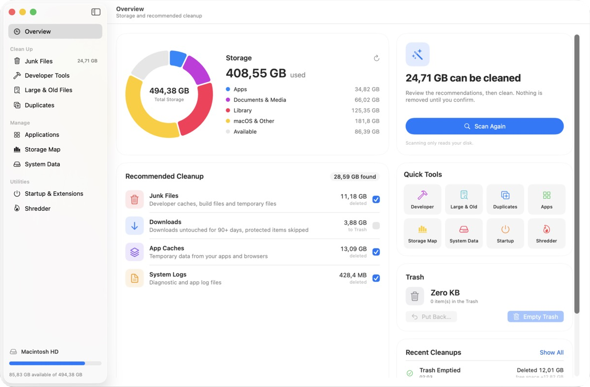
  </picture>
</p>

### Screenshots

| | |
|---|---|
| 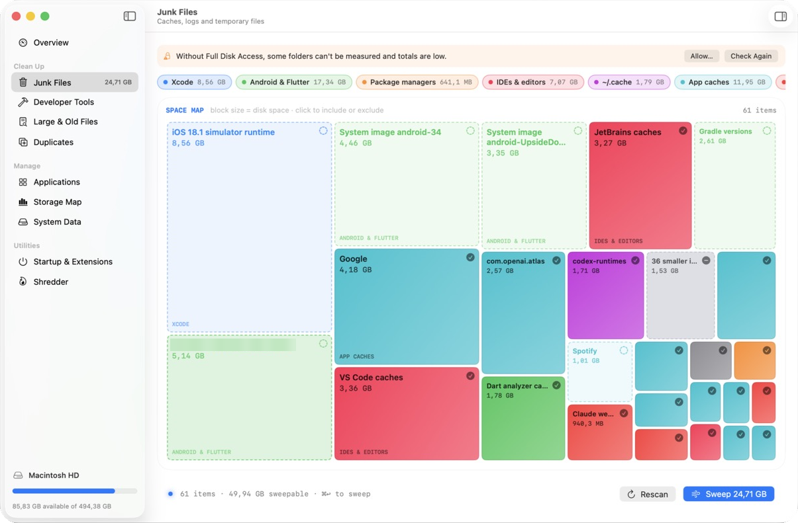<br>**Junk Files:** a map of caches, logs and temporary files, sized by disk space | 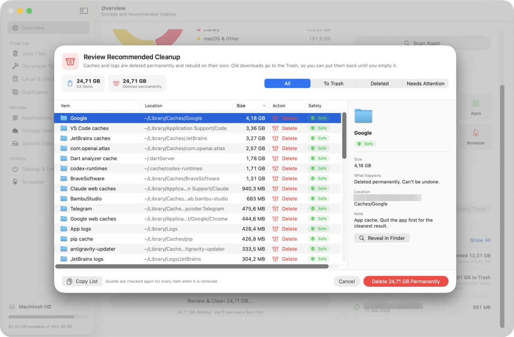<br>**Review Cleanup:** every item, its full location, size, what happens to it, and how safe it is |
| 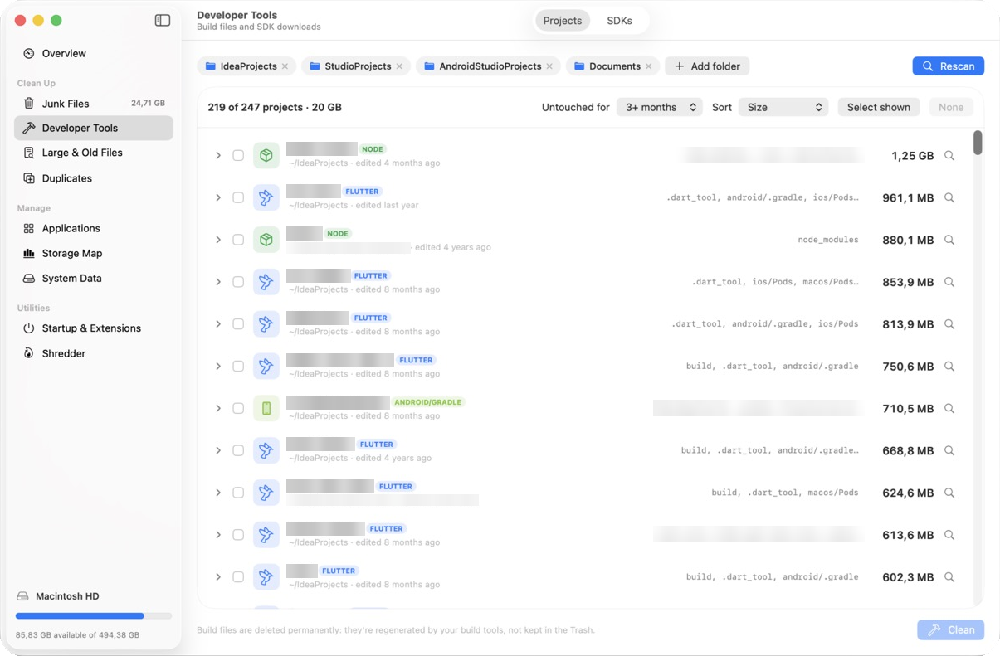<br>**Projects:** build folders in your code projects, and how long since you touched each one | 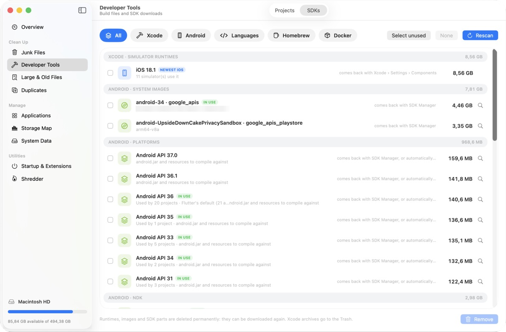<br>**SDKs:** simulators, Android parts, language versions and Docker, marked **In Use** when a project needs them |
| 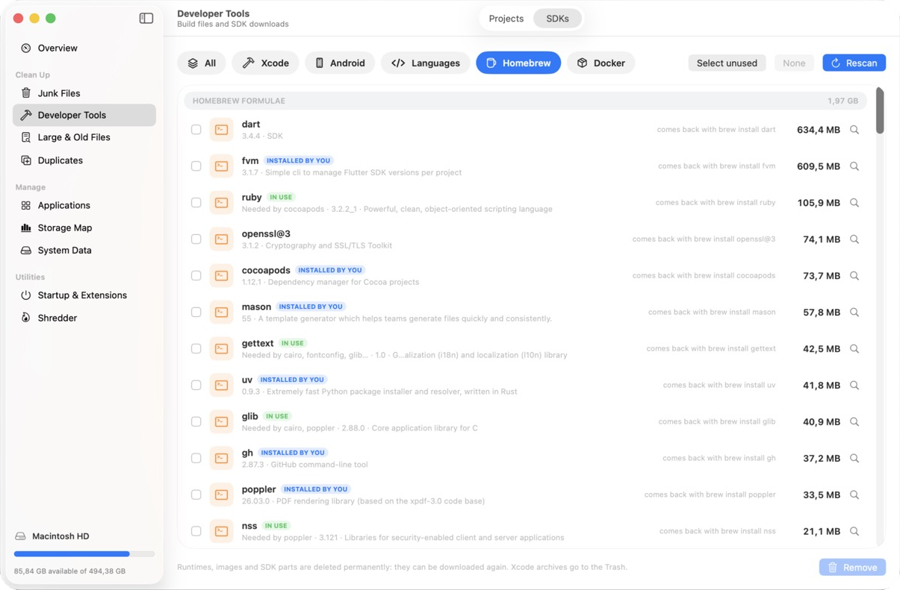<br>**Homebrew:** what you installed with `brew`, its size, and what still needs it | 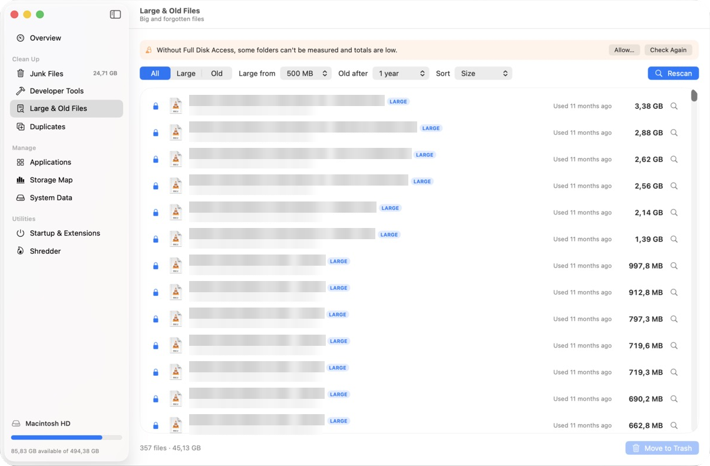<br>**Large & Old Files:** big files and files you haven't opened in months |
| 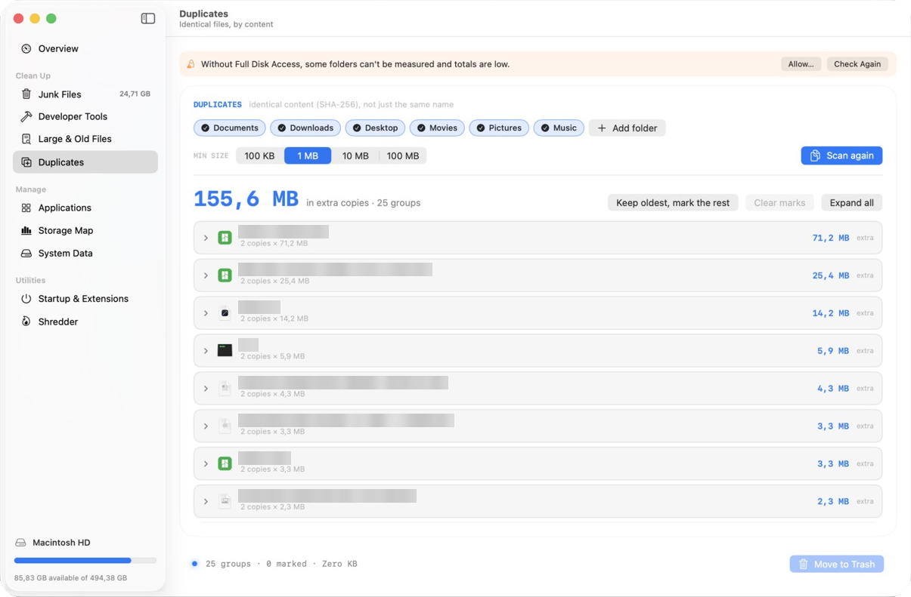<br>**Duplicates:** identical files compared by content; one copy always stays | 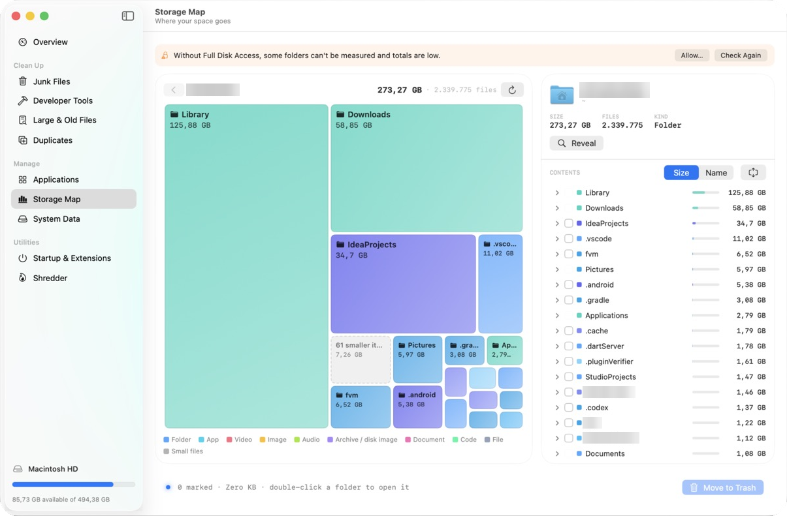<br>**Storage Map:** every folder by size, to see where your space goes |
| 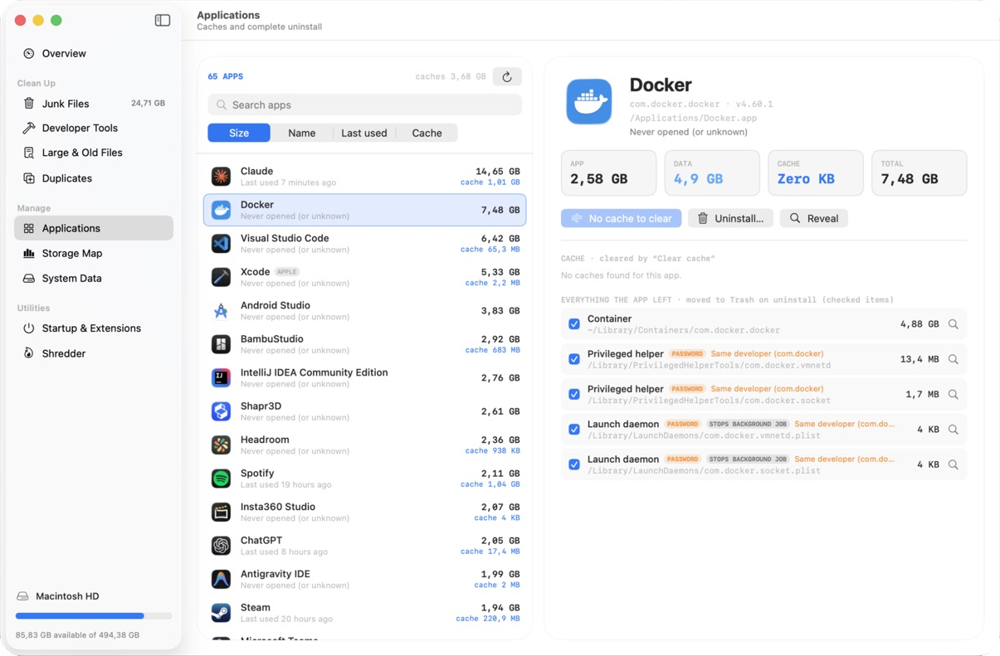<br>**Applications:** clear an app's cache, or uninstall it with everything it left behind | 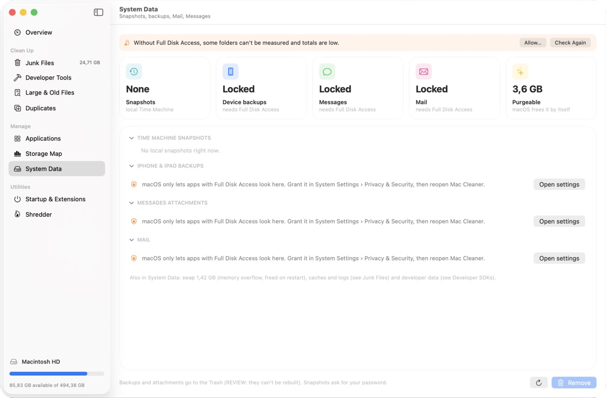<br>**System Data:** Time Machine snapshots, device backups, Mail and Messages attachments |
| 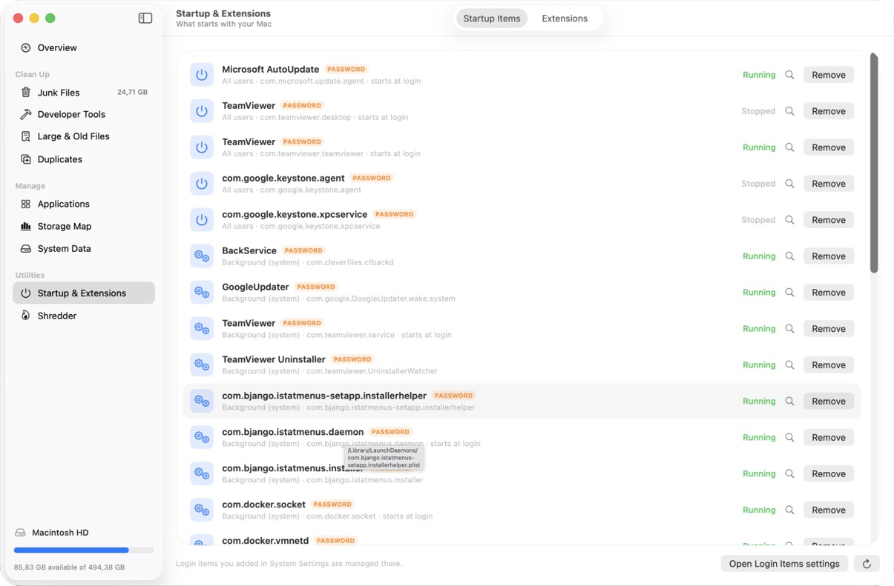<br>**Startup & Extensions:** what starts with your Mac | 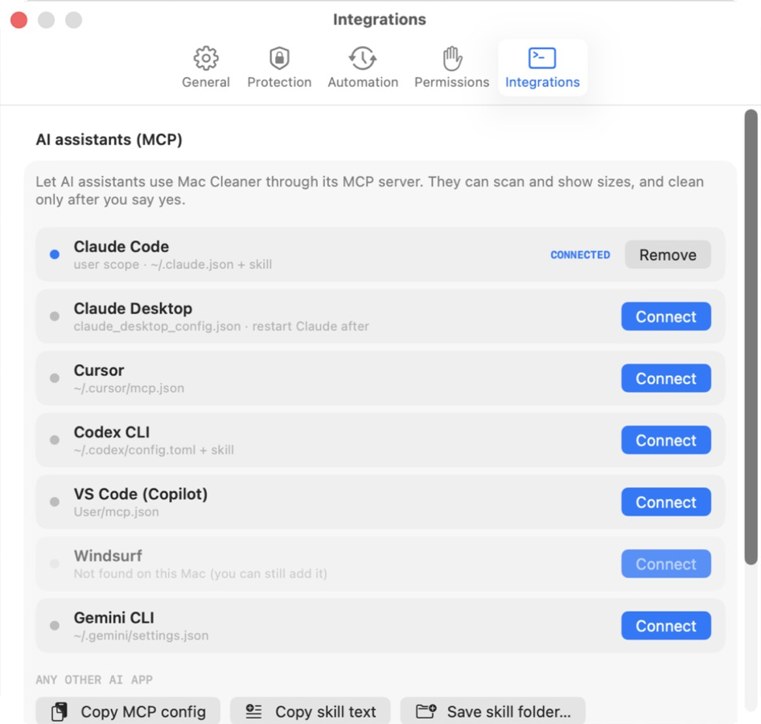<br>**Integrations:** connect Claude, Cursor, Codex, VS Code, Windsurf or Gemini |
| 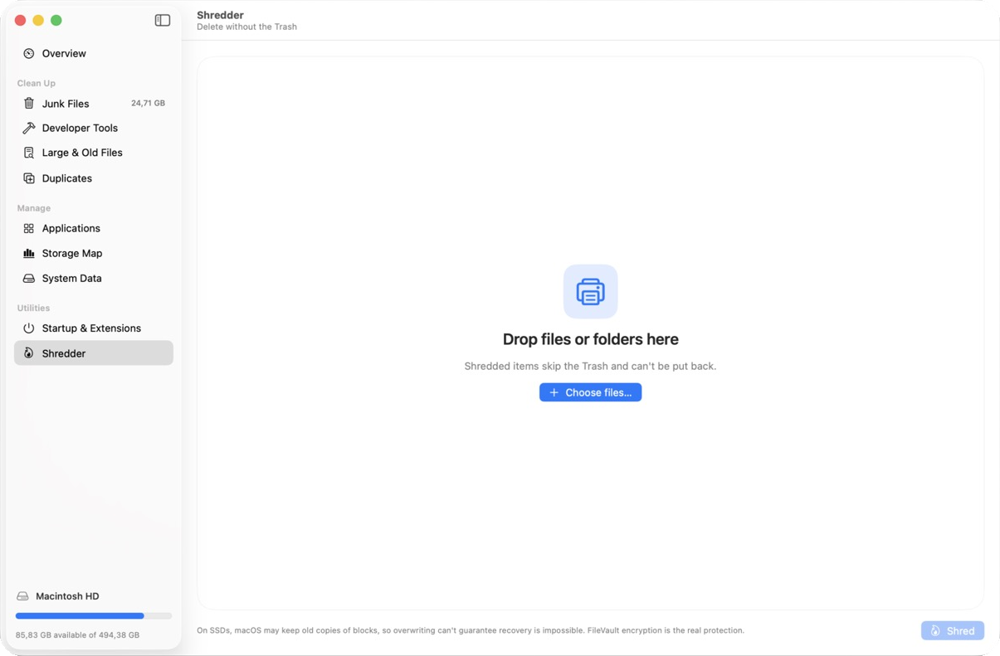<br>**Shredder:** delete files permanently, without the Trash | 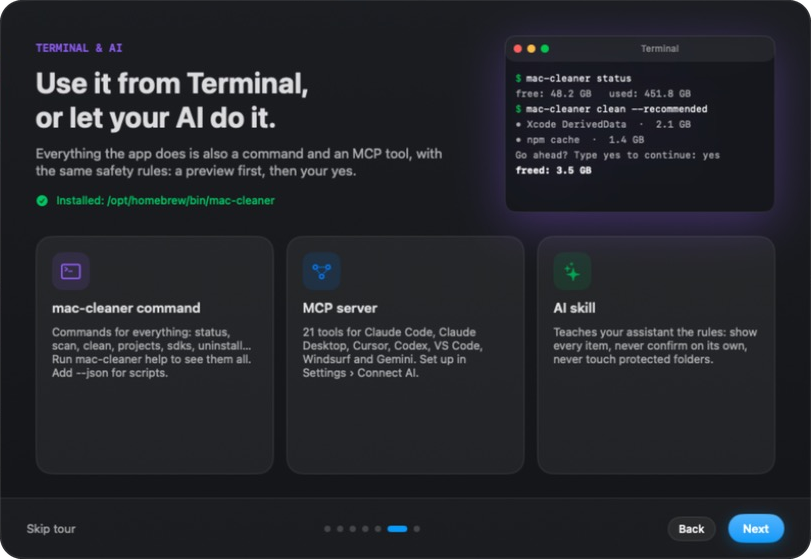<br>**Welcome tour:** the Terminal command and AI assistants |

<sub>Screenshots are from a real Mac. File, folder and project names are blurred for privacy. The Overview is shown as a full page: two captures of the same window, scrolled to the top and to the bottom, joined where they overlap.</sub>

---

## Download

1. Download the latest **`MacCleaner-x.y.z.dmg`** from [Releases](https://github.com/WahdanZ/MacCleaner/releases).
2. Open it and drag **Mac Cleaner** into **Applications**.
3. Open Mac Cleaner. The app isn't notarized by Apple yet, so the first time macOS says it can't check it. Click **Done** (not **Move to Trash**), then open **System Settings › Privacy & Security**, scroll down, click **Open Anyway** and confirm. On macOS 14 Sonoma you can also Control-click the app and choose **Open**.

Or install it with [Homebrew](https://brew.sh):

```bash
brew install --cask wahdanz/tap/mac-cleaner
```

The first launch needs step 3 too. After that, Mac Cleaner updates itself.

Mac Cleaner needs **macOS 14 Sonoma or later**. It's free and open source.

---

## Getting started

1. **Scan.** On the Overview, click **Scan for Junk**. Scanning only reads your disk.
2. **Choose.** Recommended Cleanup shows what can be removed, by category. Tick what you want.
3. **Review.** Click **Review & Clean**. You'll see every item: where it is, how big it is, whether it's deleted or moved to the Trash, and how safe it is.
4. **Clean.** Confirm. Mac Cleaner tells you how much was deleted and how much went to the Trash.
5. **Empty the Trash** when you're sure. Space taken by files in the Trash is freed only then.

A short welcome tour explains everything on first launch.

---

## What it can clean

**Clean Up**
- **Junk Files:** caches, logs and temporary files from more than 350 places, shown on a map sized by how much space they take. That includes package caches for npm, Yarn, pnpm, Bun, pip, CocoaPods, Homebrew, Cargo (Rust), Go modules, Maven and sbt (Java/Scala), RubyGems and Bundler, NuGet (.NET), Conda, Hex (Elixir), Cabal (Haskell) and Composer (PHP).
- **Developer Tools:**
  - **Projects:** build folders in your code projects, with how long since you last touched each one: `node_modules`, `build`, `Pods`, `.gradle`, `target`, `.dart_tool`, Python caches and virtual environments, .NET `bin`/`obj`, Elixir `_build`/`deps`, `.terraform`, Haskell, Zig, Elm, Carthage and more.
  - **SDKs:** old iOS simulators, Android SDK parts, Docker data, and old language versions installed with nvm, fnm, Volta, pyenv, rbenv, rustup, SDKMAN and asdf. Versions your projects still use (from `.nvmrc`, `.python-version` and similar files) are marked **In Use**.
  - **Homebrew:** every formula and app you installed with `brew`, with its size and what still needs it, uninstalled through Homebrew so brew stays in sync, plus `brew cleanup` for old versions.
- **Large & Old Files:** big files and files you haven't opened in months.
- **Duplicates:** identical files, compared by their content. One copy always stays.

**Manage**
- **Applications:** clear an app's cache, or uninstall it completely, including the data, helpers and drivers it leaves behind. Apps installed with Homebrew are marked, and can be uninstalled with Homebrew.
- **Storage Map:** explore every folder by size to see exactly where your space goes.
- **System Data:** Time Machine snapshots, iPhone and iPad backups, and Mail and Messages attachments.

**Utilities**
- **Startup & Extensions:** what starts with your Mac, plus plug-ins and drivers from other developers.
- **Shredder:** delete files permanently, without the Trash.

---

## How your files stay safe

- **You see everything first.** Every cleanup opens a review list with each item, its full location and size, and what will happen to it. Items that need a second look are marked **Review** or **In Use**, and deleting those needs an extra tick.
- **Your files go to the Trash.** Only things that rebuild on their own, like caches and build folders, are deleted permanently. Everything else can be put back.
- **Your personal folders are left alone.** Documents, Downloads, Desktop, Movies, Pictures, Music and iCloud Drive are never part of junk cleaning.
- **Protect anything.** Add folders or files in **Settings › Protection**. Nothing in Mac Cleaner, its command line or an AI assistant can touch them.
- **No system files.** Apple's own apps and system folders are never removed.
- **Honest numbers.** Mac Cleaner tells you what was actually deleted and what only moved to the Trash.
- **Private.** No accounts, analytics or tracking. Your data stays on your Mac. The only thing it asks the internet is GitHub, once a day, whether there's a new version (you can turn that off).

---

## Permissions it may ask for

| Permission | Why |
|---|---|
| **Full Disk Access** (optional) | Without it, macOS hides the Trash, Mail, Messages and other apps' data, so some sizes come out low. Turn it on in *System Settings › Privacy & Security › Full Disk Access*. |
| **Control Finder** | To measure and empty the Trash. Asked once. |
| **Your password** | Only for items outside your home folder, like an app's system helper or a Time Machine snapshot. macOS asks, not Mac Cleaner. |
| **Notifications** | For the optional low-disk alert. |

---

## Never run out of space

The **Insights** card on the Overview shows how much space you reclaimed each week (deleted vs moved to the Trash), how your free space has changed over the last weeks with a forecast of when it reaches your alert level, and which kinds of junk take the most space. Mac Cleaner notes your free space once a day to draw the trend; only the numbers are kept, on your Mac.

In **Settings › Automation**:
- **Low-disk alert:** the menu bar icon turns orange, then red, and you get a notification when free space drops below your limit (20 GB by default). The menu bar menu also shows the free-space forecast, for example "Reaches 20 GB in about 6 weeks".
- **Weekly safe clean** (off by default): clears recommended caches only. It never touches the Trash, your Downloads, your folders or anything protected.
- **Open at login** (in *Settings › General*), so the checks keep running from the menu bar.

---

## Use it from Terminal

Install the `mac-cleaner` command from **Settings › Integrations**, then:

```bash
mac-cleaner status                    # how much space is free
mac-cleaner scan                      # find junk (read-only)
mac-cleaner clean --recommended       # shows the list, then asks you to type yes
mac-cleaner projects --idle 6         # build folders in projects untouched for 6 months
mac-cleaner help                      # all commands
```

---

## Use it with an AI assistant

Mac Cleaner can connect to **Claude, Cursor, Codex, VS Code, Windsurf and Gemini**. Open **Settings › Integrations** and click **Connect** next to your app.

Your assistant can then answer "what's taking up space?" or "clean my old Xcode simulators". It follows the same rules: it shows you the list first, and removes nothing until you say yes.

---

## Questions

**I cleaned, but my free space didn't change much.**
Files moved to the Trash still take space until you empty it. Click **Empty Trash** on the Overview or in the sidebar. macOS can also take a minute to update free space, and Time Machine snapshots may hold on to deleted files until macOS releases them.

**Why do some sizes look too small?**
Without Full Disk Access, macOS hides some folders from apps. Allow it in *System Settings › Privacy & Security › Full Disk Access*, then scan again.

**Can I undo a cleanup?**
Anything that went to the Trash can be put back, from the **Put Back** button on the Overview or from Finder, until you empty the Trash. Caches and build folders are deleted, but apps and build tools recreate them when needed.

**Is it safe to delete caches?**
Yes. Caches are copies apps keep to load faster, and apps rebuild them. An app may start a little slower the first time afterwards.

**How do I update it?**
Mac Cleaner checks GitHub once a day and tells you when a new version is out, with what changed. Click **Install and Relaunch**: it downloads the new version, checks it against the release's checksum, and reopens. You can also choose **Mac Cleaner › Check for Updates…**, or turn the daily check off in *Settings › General*.

**How do I remove Mac Cleaner?**
Quit it and drag it from Applications to the Trash (with Homebrew: `brew uninstall --cask mac-cleaner`). If you installed the Terminal command, run `mac-cleaner uninstall-command` first. Your settings live in `~/Library/Preferences/io.github.wahdanz.maccleaner.plist` and `~/Library/Application Support/Mac Cleaner`.

---

## For developers

Building from source, how the app works, the command line and MCP references, and how releases are made: see **[DEVELOPMENT.md](DEVELOPMENT.md)**.

## License

[MIT](LICENSE) © 2026 WahdanZ
